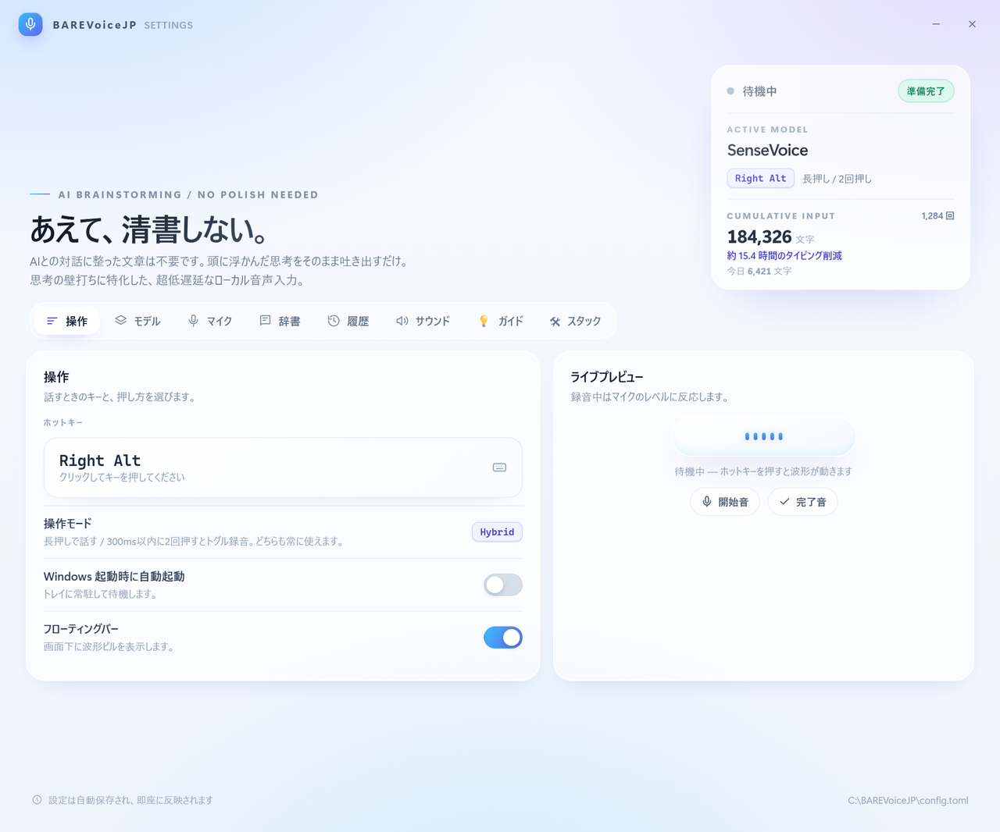
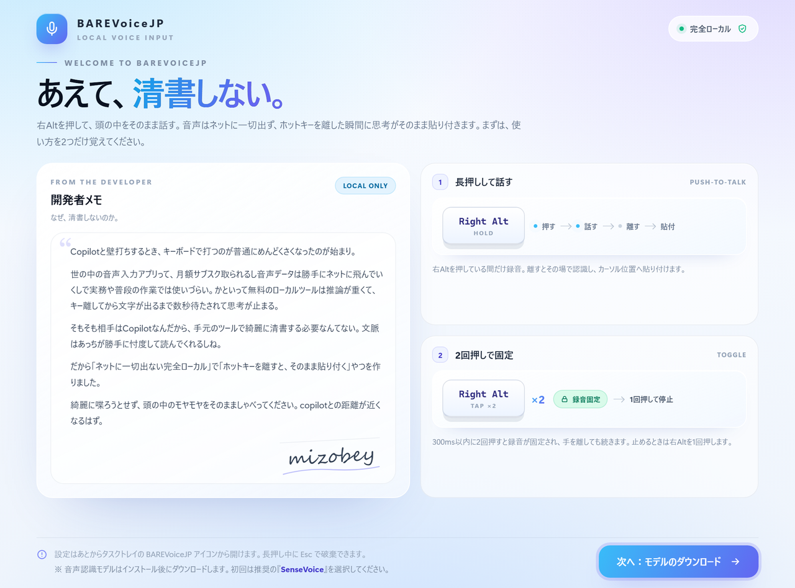
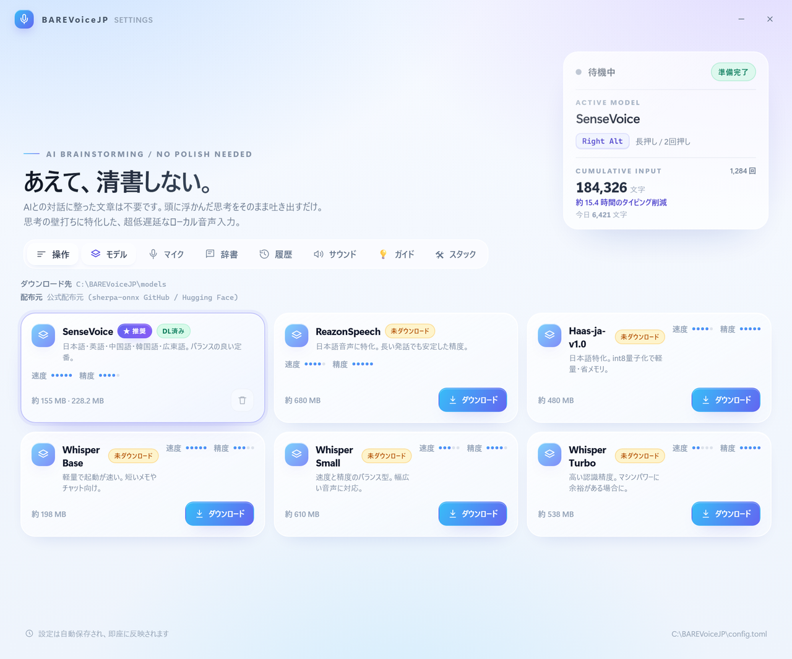

# BAREVoiceJP

右 Alt を押している間だけ録音し、離した瞬間にローカルで文字起こしして、今のウィンドウへ貼り付ける Windows 用の音声入力。

推論はすべて手元で完結する（sherpa-onnx / ONNX Runtime）。音声も認識結果も外部へ送らない。アカウント登録もクラウドも不要。



## なぜ作ったか

AIと壁打ちするとき、キーボードで打つのが面倒になったのが始まりだった。

世の中の音声入力は、月額を取られるか、音声が勝手にクラウドへ飛ぶか、無料のローカルツールなら推論が重くてキーを離してから数秒待たされるかのどれかだった。数秒の沈黙で思考が途切れるのが、いちばん惜しかった。

そもそも相手はAIなんだから、手元で整った文章に清書する必要はない。文脈は向こうが読んでくれる。必要なのは、頭の中のモヤモヤが**思考の速度のまま**文字になることだけ。

だから「ネットに一切出ない完全ローカル」で「キーを離した瞬間に貼り付く」ものを作った。この2つが崩れたら、このアプリの意味も消える。

綺麗に喋ろうとしないでいい。考えながら、詰まりながら、そのまま話してほしい。

## 特徴

- **完全ローカル** — 音声はメモリ上のバッファにしか置かず、ディスクへ書き出さない
- **押して話すだけ** — 右 Alt を押している間だけ録音。離すと貼り付く。キーは変更できる
- **2回押しで固定** — 300ms 以内に2回押すと録音が固定され、手を離しても続く。止めるときは1回押す
- **6種類のモデル** — 日本語特化から多言語・軽量版まで。初回起動か設定画面から取得する
- **日本語向けの整形** — タグ除去、空白の正規化、辞書置換、英日境界のスペース補正
- **辞書のホットリロード** — `words.txt` / `replacements.json` を保存すると次の発話から効く
- **常駐UI** — タスクトレイ、8タブの設定画面、録音レベルを出すフローティングバー、通知音4テーマ
- **実績カウンター** — 累積文字数と貼り付け回数、推定のタイピング削減時間。本文は保存しない

## 動作環境

| 項目 | 要件 |
|---|---|
| OS | Windows 10 / 11 (x64) |
| ランタイム | WebView2 Runtime（Windows 11 は標準搭載、Windows 10 は Evergreen 版が必要） |
| ランタイム | Visual C++ 2015-2022 再頒布可能パッケージ (x64)。多くは導入済み |
| マイク | 入力デバイスが1つ以上 |
| ディスク | モデル用に 160 MB 〜 700 MB |

## インストール

[Releases](../../releases) の `BAREVoiceJP-vX.Y.Z-win64.zip` を任意のフォルダへ展開し、`BAREVoiceJP.exe` を実行する。管理者権限は要らない。**展開したフォルダがそのまま保存先になる**（レジストリに書くのは自動起動の1項目だけ）。

1. ZIP を展開する
2. `BAREVoiceJP.exe` を起動し、オンボーディングでモデルを選んでダウンロードする（既定の SenseVoice で約 155 MB。進捗は設定画面に出る）
3. 右 Alt を押しながら話し、離す

SmartScreen の警告が出たら「詳細情報」→「実行」。手順と SHA256 の確認方法は ZIP 同梱の `README.txt` にある。

アンインストールは、設定画面で自動起動をオフにし、アプリを終了してフォルダを削除する。

## 使い方

- **録音**: 右 Alt を押している間。離すと推論して `Ctrl+V` を送る
- **録音の固定**: 右 Alt を2回叩く（300ms 以内）。止めるときは1回押す
- **取り消し**: 録音中に Esc
- **設定**: トレイアイコンを右クリック →「設定」
- **終了**: トレイメニューから

貼り付けは `Ctrl+V` 固定。`--paste-modifier` に `ctrl` 以外を渡すと警告が出る。200ms 未満の押下は誤操作として捨てる。



## モデル

| ID | 名前 | サイズ | 速度 | 精度 | 向いている用途 |
|---|---|---|---|---|---|
| `sensevoice` | SenseVoice | 155 MB | ★★★★★ | ★★★★☆ | 日英中韓広東語。既定・推奨 |
| `reazonspeech` | ReazonSpeech | 680 MB | ★★★★☆ | ★★★★★ | 日本語特化。長い発話に強い |
| `haas-ja-v1.0` | Haas-ja v1.0 | 480 MB | ★★★★☆ | ★★★★★ | 日本語特化。量子化で省メモリ |
| `whisper-base` | Whisper Base | 198 MB | ★★★★★ | ★★★☆☆ | 軽量。短いメモ向け |
| `whisper-small` | Whisper Small | 610 MB | ★★★☆☆ | ★★★★☆ | 速度と精度のバランス |
| `whisper-turbo` | Whisper Turbo | 538 MB | ★★☆☆☆ | ★★★★★ | 高精度。マシンパワーが必要 |

★5つが最速・最高精度。本体はアプリに同梱せず、初回起動後に取得する。既定の配布元は sherpa-onnx の GitHub Releases（Haas-ja だけ Hugging Face）。



Whisper は日本語固定。SenseVoice だけ `--language` で切り替えられる。

自前のサーバーや共有フォルダから配りたい場合は [docs/self-hosted-models.md](docs/self-hosted-models.md) を見て。

## 辞書

どちらも保存すれば次の発話から反映される（更新日時を監視している）。

`words.txt` — 正式表記と読みの対応。

```
# 正式表記 : 代表読み
GitHub Actions : ギットハブアクションズ
Docker : ドッカー
```

- 両方とも4文字以上の項目が `--fuzzy` の対象になる（既定は完全一致）
- 読みが6文字以上ならしきい値が緩む
- 助詞の誤爆を避けるため境界を見ている

`replacements.json` — ASR の戻り値を完全一致で置換する。

```json
{
  "えーぴーあい": "API",
  "ぎっと": "git"
}
```

`hotwords.txt` は受け付けるだけで、現行のエンジンはホットワードを使わない。将来の拡張用に置いてある。

## データの置き場所

すべて **exe と同じフォルダ**。自動起動でもカレントディレクトリに依存しない。

```
BAREVoiceJP.exe
config.toml          # 設定 (UI が自動生成・保存)
stats.json           # 累積実績 (文字数と回数だけ)
history.json         # 認識履歴 (直近10件、本文を含む)
words.txt            # 単語辞書
replacements.json    # 完全一致置換
hotwords.txt         # ホットワード (未対応)
models/
logs/
  app.log            # 5 MiB でローテーション、3世代保持
```

`config.toml` のキー一覧は [docs/configuration.md](docs/configuration.md)。

推論時間はログの `推論時間: <n> ms` の行に残る。モデルごとの速度はここを集計して比べられる。音声と認識結果そのものはログに出さない（`--debug` でも出さない）。

## プライバシー

- 音声はメモリ上だけ。ディスクに書かない
- `stats.json` は文字数と回数だけ。認識した本文は入らない
- 本文が残るのは `history.json` の直近10件のみ。設定画面の「履歴」から全件消せる
- モデルは取得後にサイズと SHA-256 を検証してから展開する
- リモートの配布元は HTTPS 必須。平文 HTTP はループバックだけ許可する
- アーカイブの受信・展開サイズに上限を設けて、圧縮爆弾でディスクを埋められないようにしている
- 設定画面の WebView は埋め込みページ以外への遷移・新しい窓・権限要求を拒否する
- 推論中にフォーカスが別の窓へ移ったら貼り付けず、クリップボードに残す
- `model_base_url` に認証情報を書くと `config.toml` に平文で残る（ログと画面では伏せる）

## 既知の制限

- Windows x64 専用
- 貼り付けは `Ctrl+V` 固定
- モデル本体はリポジトリにも ZIP にも入っていない
- `--denoise` は受理するが効果はない（未実装）

## 開発

ビルド、テスト、リリース手順は [docs/development.md](docs/development.md)。コマンドライン引数は [docs/configuration.md](docs/configuration.md)。

```
src/   Rust (Win32 + WebView2)
web/   設定画面とオンボーディング
```

## ライセンス

MIT。[LICENSE](LICENSE) を参照。

同梱・依存する外部コンポーネントには個別のライセンスが付く。配布 ZIP には [THIRD-PARTY-LICENSES.txt](docs/release/THIRD-PARTY-LICENSES.txt) を入れている。sherpa-onnx (Apache-2.0)、ONNX Runtime (MIT)、WebView2 Runtime (Microsoft)、Rust クレート、各 ASR モデル。モデル本体は同梱していないので、再配布する場合は各モデルのライセンスを確認すること。
